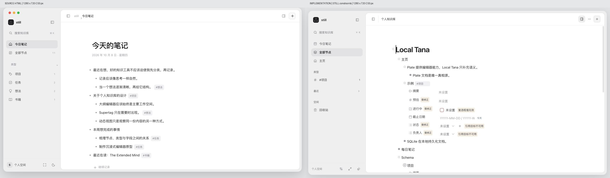
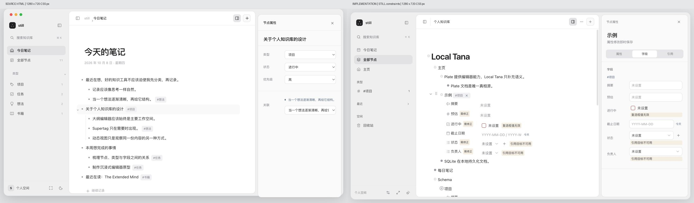

# STILL UI/UX 框架验收

日期：2026-10-09。范围：现有项目的窗口、导航、工作容器、工具栏、属性面板、主题和外围交互。Plate 编辑器与数据模型保持现有边界。

## 设计依据

- 最新约束：[STILL · UI/UX 核心设计约束](docs/plans/2026-10-09-still-ui-ux-spec.md)。
- source visual truth path：`/Users/hankyoung/Downloads/still_codex_polished.html`。
- implementation：`http://127.0.0.1:3187/editor`；Tauri 原生独立预览工作区。
- implementation screenshot path：`docs/design/still-ui/implementation-properties.jpg`。

优先级：用户明确指定的尺寸和编辑器架构约束优先于 HTML 中的演示数值。实现的是可工作的现有产品框架，HTML 演示文档及选项没有写入用户工作区。

## 对照状态与密度

| 对照 | CSS viewport | 原始截图像素 | 密度处理 | 状态 |
| --- | --- | --- | --- | --- |
| HTML / Web 主窗口 | 1280 × 720 | 两者均为 1280 × 720 | 浏览器 DPR 2；截图 API 输出 CSS 1x，组合时没有缩放 | 浅色、侧栏展开、属性面板关闭 |
| HTML / Web 属性面板 | 1280 × 720 | 两者均为 1280 × 720 | 同上 | 点击普通节点的项目标签，面板展开 |
| Native 修复前 / 后 | 1280 × 820 | 两者均为 2560 × 1640 | 按 2x 降采样为 1280 × 820 后组合 | 同一默认文档、系统深色、面板关闭 |

HTML 显示演示的今日笔记，项目显示已有的默认知识库文档。文档标题、字段名、选项数量、日期、节点计数属于动态内容，不用于逐字或像素误差评分。重点对照窗口比例、容器、导航、文字层级和属性控件。原生截图左上角的紫色录屏提示由系统提供。

### 全幅对照

### 局部对照

- [导航、Logo 和小字](docs/design/still-ui/comparison-navigation.jpg)
- [工具栏控件和分隔](docs/design/still-ui/comparison-toolbar.jpg)
- [属性表单](docs/design/still-ui/comparison-property-controls.jpg)
- [标题与正文文字层级](docs/design/still-ui/comparison-type.jpg)

这些局部截图保持 CSS 1x，未拉伸控件和字体；不同内容、轨道宽度和高度通过留白处理。

## 五项视觉核查

| 项目 | 检查结论 |
| --- | --- |
| 字体与排版 | 使用系统字体栈。标题 31px、正文 14px，导航 12.5px、属性 12px；较 HTML 的 34px 标题收敛。粗细、行高、层级和截断在全幅与局部图中可读，没有加载外部字体。 |
| 空间与布局 | 侧栏融入底板，正文与检查器各自成为工作容器。自动测试确认默认 240px / 52px / 最大 740px、17px / 13px 圆角和 8px 容器间距。760px 导航抽屉、1000px 面板浮层、1440px 并列布局实测，无横向溢出。 |
| 色彩与 Token | 中性灰白、低对比边界，统一 `still-tokens.css`。深色和跟随系统使用同一语义 Token；旧 Tana / shadcn 变量映射到这一套 Token。选中、焦点、禁用、错误与警告均有对应状态。 |
| 图标与素材 | 原型没有照片或插画。复用原型提供的 `∴` 字形品牌标记及现有 Lucide 图标。没有新增装饰图、渐变或模拟系统交通灯。原生构建的图标尺寸遗漏已修复，见迭代记录。 |
| 产品文案与内容 | 导航统一为今日笔记、全部节点、类型、最近、回收站；保留实际存在的主页入口。搜索和新建各有主要入口，其他命令集中在菜单。属性即时保存、空值、损坏引用与已删除定义继续反映实际数据。 |

## Findings / 对照迭代记录

### 迭代 1 — blocked

- **[P1，已修复] Tauri 静态构建遗漏共享组件样式。**
  - 位置：共享 `src/app/globals.css` 的 Tailwind 源扫描。
  - 证据：[原生修复前](docs/design/still-ui/native-iteration-1.png)。图标过大、品牌和导航布局失真、正文容器未取得 flex 伸展、字段间距错位。
  - 影响：原生布局与 Web 及参考原型明显不一致，正文阅读和字段操作受影响。
  - 修复：在共享样式表中声明 `@source "../"`，让 Tauri 的构建入口扫描共享 `src` 组件。重新生成静态资源和原生 bundle，关闭旧进程后重新启动。

### 迭代 2 — passed

- [原生前后组合对照](docs/design/still-ui/comparison-native.jpg)确认图标、Logo、容器宽度和字段行布局已修复。
- [原生属性面板](docs/design/still-ui/native-properties.png)与[原生专注模式](docs/design/still-ui/native-focus.png)确认面板联动及标题栏控制区预留。
- Web 完成等视口的全幅与局部对照；没有剩余可执行的 P0 / P1 / P2 框架问题。

功能核查中同时修复了 Quick Add 在 Slate DOM 注册前获取焦点的问题；完整浏览器测试及 `pageerror` 断言通过。选项创建改为按需 Popover，专注模式下打开属性会退出专注模式，关闭属性后回到已有 Plate 光标位置。

## 可接受的实现差异

- HTML 的固定侧栏、顶栏和正文数值调整为用户规范中的 240 / 52 / 740。
- HTML 属性面板仅有演示选项。项目保留真实字段、引用和配置能力，使用同一紧凑控件体系；不复制演示的第二套文档或候选状态。
- 项目默认示例中已有无效字段值和引用，因此截图有验证提示。提示继续由现有字段校验派生，不为截图隐藏或修正文档数据。
- Web 不绘制假的 macOS 窗口按钮；原生窗口使用实际系统按钮与拖动区域。

## 交互与技术验证

- 主导航、最近/固定节点、侧栏宽度与 full / mini / hidden 状态。
- 搜索、命令面板、新建、Quick Add、每日笔记和历史导航。
- Supertag 打开宿主属性而不跳页；关闭面板恢复 Plate 光标；原位编辑写入同一文档，刷新后保留。
- 选项按需创建并选择；折叠、缩进、拖动、引用、字段和回收站回归流程。
- 专注模式保持上下文，属性操作可退出专注模式；760px 抽屉在导航后关闭。
- 显式浅色覆盖系统深色，偏好刷新后保留，恢复跟随系统有效；支持 reduced motion。
- 最终浏览器预览检查 `warn` / `error` 日志为空。完整浏览器测试的 WebServer 日志无 `[browser]` 错误或警告。

| Gate | 结果 |
| --- | --- |
| `bun test` | 435 pass，0 fail |
| `bun run test:ui` | 62 passed |
| `bun run typecheck` | passed |
| `bun run lint` | passed |
| `bun run build` | passed |
| `bun run tauri:check`（包含 `build:tauri`） | passed |
| Tauri debug `.app` bundle | passed；已生成常规应用与独立预览应用 |
| `git diff --check` | passed |

## 原生验证范围

本机原应用已有数据库启动时返回 `Unsupported database schema`。原数据没有清空或重置；原生 UI 使用独立应用标识 `app.localtana.still-preview` 的预览工作区验证。原应用旧数据库的迁移/恢复不属于本次 UI 框架改动，仍未验证。构建产物通过不等于这个旧数据库已可打开。

中断恢复后已重新启动本地预览服务。浏览器工具重新连接被 URL 安全策略拒绝，未绕过该限制；本报告的交互及控制台证据来自中断前已完成的验收。恢复后没有功能改动，最终截图组合已从保存的实际截图重新生成并复核。

## Implementation Checklist

- [x] 独立窗口/工作容器，统一布局 Token。
- [x] 精简工具栏和导航，属性按需展示。
- [x] 紧凑字段编辑复用现有 Plate transforms。
- [x] 原生与 Web 共用样式，检查标题栏和窄窗。
- [x] 完整回归测试、生产构建、截图对照及控制台检查。
- [x] 保留运行中的本地预览。

final result: passed
