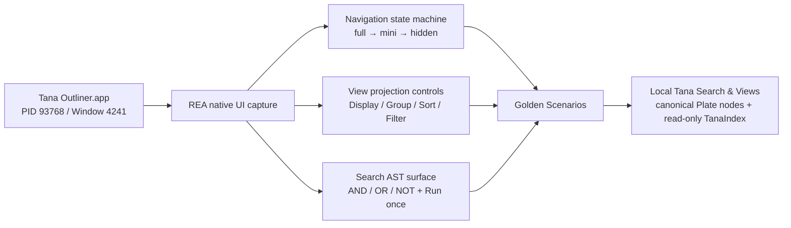

# 原版 Tana 逆向学习记录

本记录保存使用 REA 对本机已安装的 Tana Outliner（Electron 桌面包）进行的授权、被动观察结果。它把已观察行为和待验证假设分开，作为本项目 Search & Views 对齐的验收基线。

## 工具与目标

- REA：`rea-agents@6.3.0`，已注册到 `/Users/hankyoung/.codex/config.toml` 的 `mcp_servers.rea`。
- REA 技能：`reverse-engineer-anything`，安装版本 34。
- 目标：`/Applications/Tana Outliner.app/Contents/MacOS/Tana Outliner`。
- 目标 SHA-256：`9343ff737292a0bceed7a1a5e22293189bf4e19a40ae6e0290dcee11fe7eac7e`。
- 观察窗口：PID `93768`，窗口 ID `4241`，标题 `Tana Outliner`。

可复核的 REA Evidence：

- 基线首屏与无障碍树：`ev_c276c631791168808a4a310ecbb819a65b98d70a5eeea95acbef67969faa19b4`。
- 导航第一次切换：`ev_4352714cc7a36b07df92002488bd8f15b241e9ab90d4aae61ad989dd355852ac`。
- 导航第二次切换：`ev_128db086343a2069a82e3b01be245b1395287fceb4dbad3a25669515aa98f682`。
- 导航恢复展开：`ev_842f38869755b87dcdf915aa25e811bea22a3040a29c649fedb020384ceb499f`。
- 顶栏按钮与窗口状态：`ev_0972918f3879554fc88ec27920be5b718ad0a4b931a18af2f28630ebe513ad40`。
- Search Query builder：`ev_77b212011174c2974d2d31b3a44bc786883aeb3e3b75a7e15df46de9d18866d9`。

重启 Codex 后通过已注册的 REA MCP 复核的 Evidence：

- MCP 原生基线（PID `93768`、窗口 `4241`）：`ev_e7604f768095af5c69ab11ee7cec8d15fb861d86208bba0dcbe68fc3326eb5e4`。
- Search 摘要（`task (base type)` 且 `not done`）：`ev_0df0f7a9344a1e7ca614a120aeb48623f889edf0329eb155a0a985a6182eead6`。
- Query builder（规范化 AST 与 Run once/Done）：`ev_230ac6443aa9a41efc6dc1b044cc4273fd5397e7e451d222a5546de21e44aa0f`。
- Search operators 菜单（含 `PARENTS DESCENDANTS`、`GRANDPARENTS DESCENDANTS`、`LT`、`GT`、`CHILD OF`、`OWNED BY` 等）：`ev_f6dd390ed0c42519f50a771e7a2c16d214b5c6b01f3ac4d0fb4cf1bce6a5c65b`。

本轮 MCP 会话的完整证据包已保存在本机临时路径 `/tmp/tana-rea-evidence-2026-10-10.json`；原始包包含本地工作区节点文本，不提交到公开仓库。

## 证据到产品模型

这条链路只把 Evidence 中实际观察到的 UI 行为作为事实；Search host context、broken filter、结果容量和跨 View 写入路径属于待在本项目中用 Golden Scenarios 验证的产品约束，不把静态推断写成原版运行事实。

## 已观察行为

### 导航状态是单一三态循环

原版顶栏左侧只有一个导航切换入口，连续点击的状态序列是：

`展开（完整标签） → 迷你（仅图标） → 隐藏（内容区顶到左边） → 展开`。

迷你态保留 Today、Supertags、Recents、AI chats、Create new、Search 等入口的图标命中区；隐藏态不保留导航栏宽度。状态切换不改变当前页面、查询结果或节点内容。项目实现应让同一入口负责这三个状态，避免同时出现多个互相竞争的“收起/隐藏/切换”按钮。

### 顶栏与内容区是两个层次

原版顶栏依次暴露导航切换、后退、前进、新建页签、通知、帮助、快捷键、离线状态和设置。页面内容区另有 Daily notes、日期导航、Workspaces、搜索结果和 View 工具栏。窗口级控制不应混入页面内容工具栏；专注模式下应保留一个可预测的退出入口。

### View 工具栏是显式的查询结果控制层

对 `Open tasks` 结果打开工具栏后，观察到：

- `Filter by name`
- `Display`
- `Group`
- `Sorting active`
- `Filter by`

`Display` 菜单把 User-defined fields 与 System fields 分组列出复选框；`Group` 菜单允许按字段分组，并在用户字段后标记 `Global`；`Sort by` 显示当前排序字段、方向、`Add sort`、`Reapply sort`、`Reset`。这说明 View 配置属于结果集合的展示层，应与 Search 的匹配语义分开保存。

### Search 结果仍然是普通节点

无障碍树中搜索结果行继续暴露文本输入区、复选框、标签按钮和节点按钮；View 工具栏只改变筛选、字段显示、分组和排序入口，不创建第二份编辑文档。当前项目必须继续遵守 Plate 文档是唯一编辑真相、TanaIndex 只读派生的约束。

### Query builder 显式保留 AST 结构

原版 Search options 显示可读的查询摘要：`Search for nodes tagged task (base type) and not done`。打开 Query builder 后，界面保留 `AND` 根节点和 `AND / OR / NOT` 插入操作，并提供 Search operators、System fields、Field values、Tag types、Workspace 等入口；底部同时显示规范化摘要 `(Tagged:task (base type)) AND (NOT is:Done)`，以及 `Run once` 与 `Done`。这支持“保留 AST、重做交互层”的重构方向，而不是把查询降级为单行文本。

### 本轮补充：命令菜单、View 面板与节点 Options

在 Today 页面对 `Open tasks` 节点进行被动观察后，命令菜单显示 `100 results available`，并把当前节点上下文动作集中在同一个入口：Find nodes、标签增删、Move to、Move and leave reference、View as（Outline/Table/List/Cards/Lanes/Tabs/Calendar/Side menu）、Filter/Sort/Group/Display、Zoom、Open in tab、Pin to sidebar、Copy/Download/Export、Show edit log、字段 Autofill 等。菜单还明确给出 Up/Down、Enter、Escape、Tab 的键盘提示。该入口证明“节点动作”和“视图动作”共享当前 Plate 选中上下文，而不是由每个 renderer 自己维护选中节点。

View 工具栏的四个配置入口分别打开独立面板：Display 按 User-defined fields/System fields 列出字段复选框；Group 将用户字段标记为 `Global`；Sort by 提供字段、方向、Remove sorting、Add sort、Reapply sort、Reset；Filter by 先选 Tags/字段，再在 Tags 子面板中区分 `Any tag`、`No tag` 和具体标签。节点 Options 还把 View as、Appearance、Copy/Duplicate、Publish、Add tag/description/checkbox、Show progress bar、Show edit log、Delete、More commands 集中在一个节点级菜单中；Search/Related content 节点额外提供 `Prefer area: Content bottom/Content right`、`Remove from #Day`、`Edit related content`。

侧栏按钮的原生可访问名称会随状态改变：完整态是 `Show mini sidebar`，迷你态是 `Hide sidebar`，隐藏态是 `Show sidebar`。隐藏态的内容区直接顶到窗口左侧，迷你态保留图标命中区；这与项目的三态 `sidebarMode` 应保持同构。完整功能与交互目录另见 [`docs/tana-feature-interaction-matrix.md`](./tana-feature-interaction-matrix.md)。

顶栏 `Keyboard shortcuts` 面板按 Navigating、Editing、Formatting 分组显示快捷键，包含 `⌘K` 命令行、`⌘M`/`⌃⌘M` 面板切换、`⌘T`/`⌘W` 页签、`⌘\\` 侧栏、Tab/⇧Tab 缩进、`⌘⏎` 完成、`⇧⏎` 插入节点、`>` 创建字段、`@` 引用和 `#` 标签。快捷键表把“节点编辑”和“窗口导航”明确分成两类，后续对齐应分别验证，不能用窗口状态代替 Plate 编辑行为。

## Golden Scenarios

以下场景用于后续 A+B 重构验收：

1. **导航三态**：在同一页面连续点击导航入口，验证完整、迷你、隐藏、完整四个状态；页面节点、滚动位置和选中结果身份保持不变。
2. **Search host context**：在 Project 节点下创建 Search，使用 `PARENT` 查询日期字段；把同一 Search 切换为 Table、Cards、Outline，候选节点身份和 `PARENT` 解析保持一致。
3. **View 配置隔离**：Table 保存排序与可见字段；Cards 保存分组与卡片字段；来回切换后两组配置分别恢复，不互相覆盖。
4. **过滤失败关闭**：删除 View 所依赖的字段定义，结果应进入 broken/diagnostic 状态并收窄为零匹配，不能因为字段失效而扩大结果集。
5. **分组与分页顺序**：先对完整过滤结果分组，再应用分页；同一分组不会因页码重复出现，组计数与折叠状态稳定。
6. **统一新增路径**：Outline、Table、Cards、Calendar 对同一 Search 新增结果，均委托 Search-owned writer；创建位置、canonical NodeId 和 mismatch 诊断一致。
7. **容量诊断**：超过系统结果上限时显示 `too-many-results` 诊断并要求缩小查询范围，不能静默截断为前 N 条。
8. **编辑闭环**：在 Table 修改字段，在 Cards 修改同一节点，再回到 Outline；三种展示都看到同一个 canonical 节点和最新字段值。

## 未决项与边界

- 原版当前窗口显示 `WORKING OFFLINE`，本轮没有把私有同步协议、账号数据或网络请求当作已观察事实。
- REA 的 `analyze-javascript-application` 已对桌面包启动，但该版本的 48 个打包脚本在静态 AST 投影阶段耗尽 Node 堆（分别在 CLI 的 4GB/8GB 上限复现）；重启后通过 MCP provider 重试时返回 `Transport closed`，未生成可用应用图。因此不能把未完成的静态图误写成覆盖结论。原生 UI Evidence 仍然有效。
- 原版 Electron CDP 端口 `127.0.0.1:8262` 要求 Bearer OAuth；当前会话未取得该授权，所以没有绕过认证读取页面脚本或私有网络数据。
